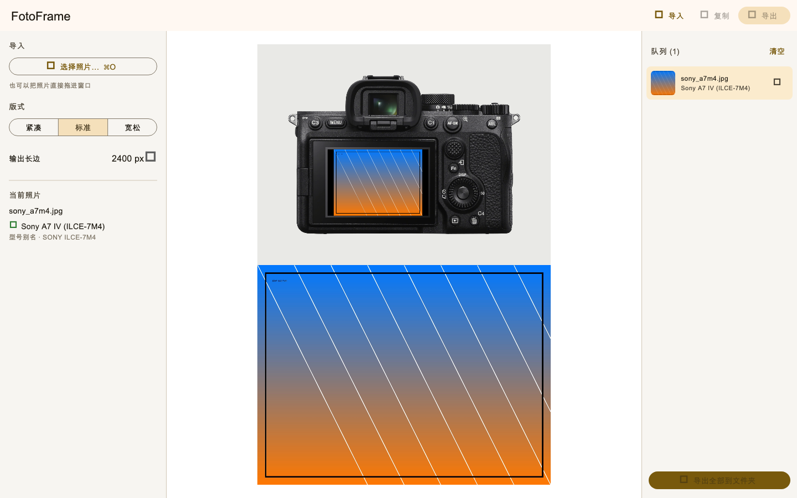

# FotoFrame

把照片「套」回拍摄它的相机里：读取照片 EXIF 自动识别相机型号，
把照片合成进对应相机官方背面图的屏幕区域，下方排布原始照片，导出成图。

## 下载

[**⬇️ 下载 macOS 安装包（v1.0.0）**](https://github.com/h2fe1/FotoFrame/releases/latest)  
Universal（Apple Silicon / Intel）· macOS 12+ · 首次打开需右键 → 打开



## 支持的相机机型（26 台）

读取 EXIF `Make` / `Model` 自动匹配；索尼按 ILCE 内部编号映射，不支持的机型会明确提示。

| 品牌 | 机型 | EXIF Make / Model |
|---|---|---|
| Hasselblad | X2D 100C | `Hasselblad` / `X2D 100C` |
| Hasselblad | X2D II 100C | `Hasselblad` / `X2D II 100C` |
| Hasselblad | CFV 100C | `Hasselblad` / `CFV 100C` |
| Leica | D-LUX 8 | `LEICA CAMERA AG` / `LEICA D-LUX 8` |
| Leica | Q2 | `LEICA CAMERA AG` / `LEICA Q2` |
| Leica | Q3 | `LEICA CAMERA AG` / `LEICA Q3` |
| Leica | SL2 | `LEICA CAMERA AG` / `LEICA SL2` |
| Leica | SL3 | `LEICA CAMERA AG` / `LEICA SL3` |
| Panasonic | S1 II | `Panasonic` / `DC-S1M2` |
| Panasonic | S1R II | `Panasonic` / `DC-S1RM2` |
| Panasonic | S9 | `Panasonic` / `DC-S9` |
| Ricoh | GR II | `RICOH IMAGING COMPANY, LTD.` / `RICOH GR II` |
| Ricoh | GR III | `RICOH IMAGING COMPANY, LTD.` / `RICOH GR III` |
| Ricoh | GR IIIx | `RICOH IMAGING COMPANY, LTD.` / `RICOH GR IIIx` |
| Ricoh | GR III HDF | `RICOH IMAGING COMPANY, LTD.` / `RICOH GR III HDF` |
| Ricoh | GR IV | `RICOH IMAGING COMPANY, LTD.` / `RICOH GR IV` |
| Sony | A1 II | `SONY` / `ILCE-1M2` |
| Sony | A7C II | `SONY` / `ILCE-7CM2` |
| Sony | A7 III | `SONY` / `ILCE-7M3` |
| Sony | A7 IV | `SONY` / `ILCE-7M4` |
| Sony | A7 V | `SONY` / `ILCE-7M5` |
| Sony | A7R III | `SONY` / `ILCE-7RM3` |
| Sony | A7R IV | `SONY` / `ILCE-7RM4` |
| Sony | A7R V | `SONY` / `ILCE-7RM5` |
| Sony | RX1R II | `SONY` / `DSC-RX1RM2` |
| Sony | RX1R III | `SONY` / `DSC-RX1RM3` |

完整匹配规则与逐台说明见 [docs/supported_cameras.md](docs/supported_cameras.md)。

## 功能

| 功能 | 说明 |
|---|---|
| 自动识别 | 读 EXIF Make/Model 自动匹配机型，索尼按 ILCE 内部编号映射；不支持时明确提示 |
| 拖拽导入 | 把 JPG/PNG/HEIC/TIFF/DNG 直接拖进窗口（原生 NSView 拖拽目标） |
| 容器格式 | EXIF 解析覆盖 JPEG(APP1) · TIFF/DNG · PNG(`eXIf`) · HEIC/HEIF(`meta`→`iinf`/`iloc`)；无 EXIF 的图给出温和提示 |
| 批量队列 | 多选导入，队列逐张显示识别结果，支持逐条移除 |
| 批量导出 | 选一个文件夹，按 `<原名>_framed.png` 全部导出 |
| 主题 | 固定相纸灰背景 · 底部原图左右下三边出血贴边 · 3 档版式松紧 · 输出长边 1600/2400/3200 |
| 外观 | 跟随系统浅色/深色；窗口无标题栏，工具栏与红绿灯同高 |
| 屏幕 | 相机屏幕按官方显示区比例（4:3 / 3:2 / 16:9，逐台校准）cover 裁剪填入，四周保留边框；比例不符的机型按真实相机留黑边 |
| 复制 | ⌘⇧C 把成图以 PNG 写入系统剪贴板（NSPasteboard） |
| 快捷键 | ⌘O 导入 · ⌘E 导出当前 · ⌘⇧C 复制 |

## 当前状态

- ✅ macOS 版可构建运行（Flutter 3.47.9 stable）
- ✅ 核心逻辑纯 Dart、零 Flutter 依赖（`app/lib/core/`），为 Windows/Android/iOS 移植做好准备
- ✅ 26 台相机资产全部按实物素材逐一标定屏幕四角
- ✅ 界面：工具栏 + 纸面排版的工作台（当前照片 · 作品 · 队列），浅色/深色跟随 macOS 自动切换
- ✅ 拖拽导入、批量导出、复制到剪贴板
- ✅ 端到端验证通过：真实 macOS 应用读样片 → EXIF 识别（索尼 ILCE 别名）→ 渲染导出

## 目录

```
app/            Flutter 应用（macOS 先行，可扩展 Windows/Android/iOS）
  lib/core/     纯 Dart 核心：EXIF 解析、机型匹配、版面几何、单应变换
  lib/render/   Flutter Canvas 渲染层
  lib/services/ 渲染服务（解码/合成/编码，UI 无关）
  lib/platform/ 平台通道（拖拽、剪贴板）
  lib/ui/       界面
  assets/cameras/ 相机背面图资产（扁平化打包 + catalog.json 屏幕标注与 EXIF 匹配规则）
assets/cameras/ 相机资产源文件（官方产品图 + meta.json，不入库，见 .gitignore）
tools/          资产与构建工具
samples/        带真实 EXIF 的测试样片（jpg / png / heic）
renders/        界面截图（各机型渲染样张由 `flutter test` 按需重新生成，不入库）
docs/           架构与机型文档
```

## 工具

| 脚本 | 作用 |
|---|---|
| `tools/flutter.sh` | Flutter 环境封装（隔离 HOME/PUB_CACHE 到 .toolchain） |
| `tools/sync_assets.sh` | 把 assets/cameras 打平同步进 app 资产目录，生成 catalog.json |
| `tools/annotate_screen.py` | 屏幕区域自动检测（白底轮廓 + 局部平滑度最大矩形） |
| `tools/measure_screens.py` | 屏幕标注审计：标注/实测/官方比例对照（`--debug` 出叠加图） |
| `tools/annotate_opening.py` | 检测屏幕开口（玻璃内沿）写入 `screen.opening`，成图上把照片外那圈玻璃灰压黑 |
| `tools/trim_assets.py` | 裁剪白边并同步平移屏幕标注 |
| `tools/grid.py` | 坐标网格叠加，手工精修标注用 |
| `tools/make_samples.py` | 生成带 EXIF 的测试照片 |
| `tools/icon/` | app 图标「Fo」字标：几何自绘、7 个尺寸一键装进 AppIcon |

## 开发

```bash
cd app
../tools/flutter.sh pub get
../tools/sync_assets.sh              # 资产变更后
../tools/flutter.sh run -d macos     # 运行（需 Xcode 可写 ~/Library）
../tools/flutter.sh test             # 全部测试（含像素级渲染断言 + 全机出图）
../tools/flutter.sh build macos      # 出包
```

无头自检（CI 可用）：

```bash
../tools/flutter.sh build macos --debug \
  --dart-define=SELFTEST=<照片路径> --dart-define=SELFTEST_OUT=<输出.png>
```

## 资产工作流

1. 收集官方背面图 → `assets/cameras/<brand>/<slug>/back.jpg` + `meta.json`
2. `tools/annotate_screen.py` 自动检测屏幕四边形，生成 `screen_debug.png` 供核对
3. `tools/trim_assets.py` 裁白边（原图备份为 back_untrimmed）
4. 手工修正个别标注（亮屏图、反光渐变图自动检测会偏差）
5. `tools/sync_assets.sh` 打包

> 相机背面图取自各品牌官方产品图，原始资产（`assets/cameras/`）不随仓库分发；
> 仓库内 `app/assets/cameras/` 已包含打包好的运行所需文件，可直接构建运行。

## 移植路线

- `lib/core/` 纯 Dart（EXIF 解析、机型匹配、版面几何、单应变换）——直接复用
- `lib/render/` 仅依赖 Flutter Canvas——全 Flutter 平台通用
- `lib/platform/` 与 UI 层按需替换：Windows 用同套 Flutter 桌面支持；
  Android/iOS 替换文件选择/保存为系统相册 API

## License

[MIT](LICENSE) © 2026 FotoFrame contributors
