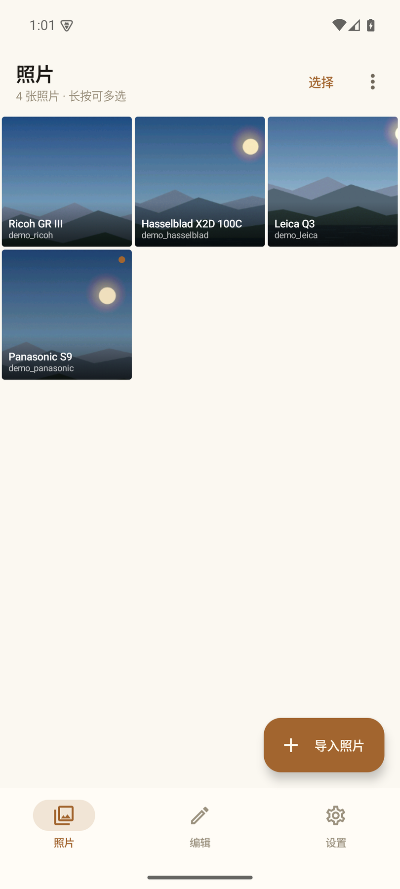
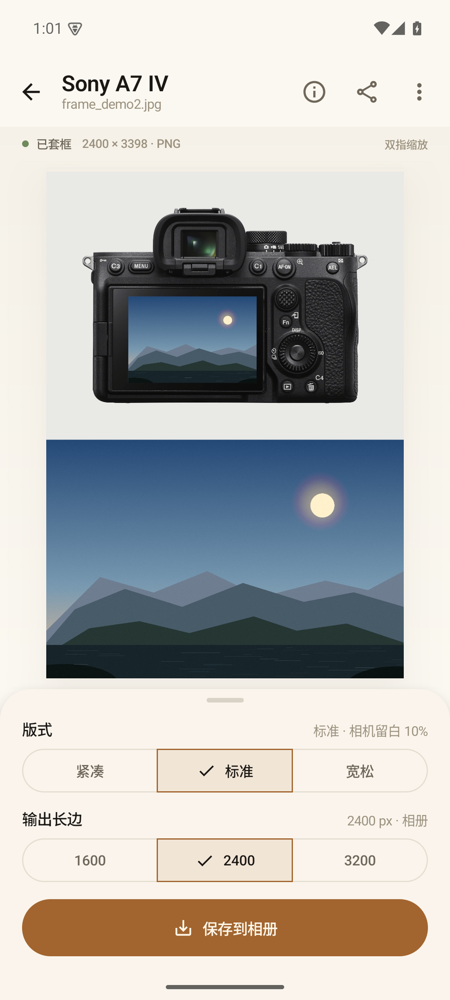
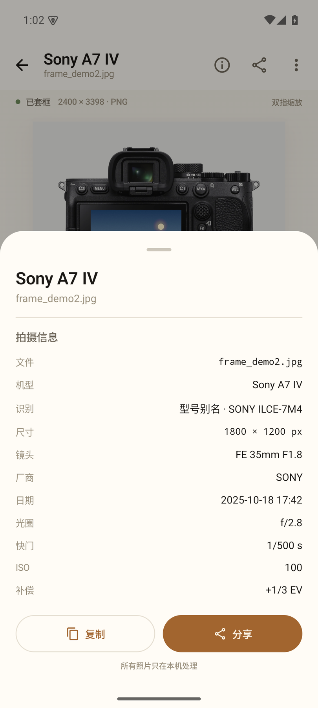
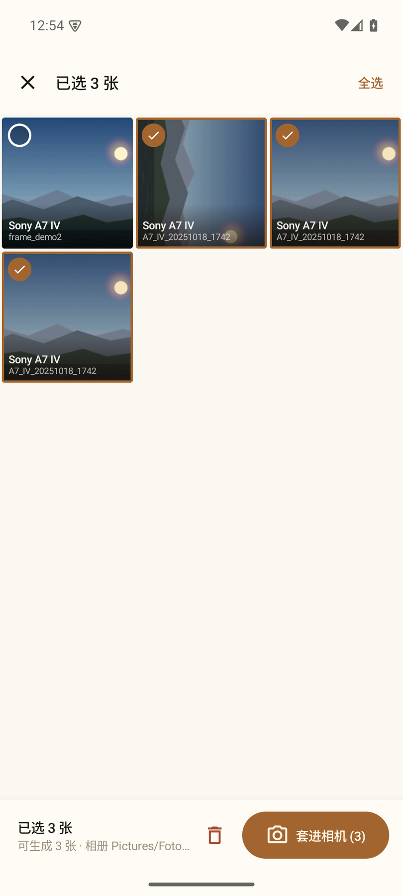
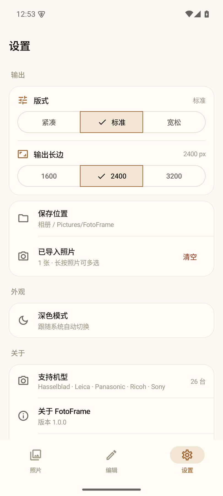
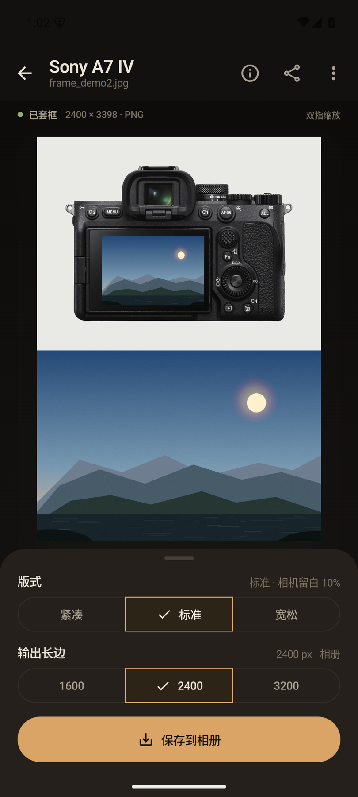
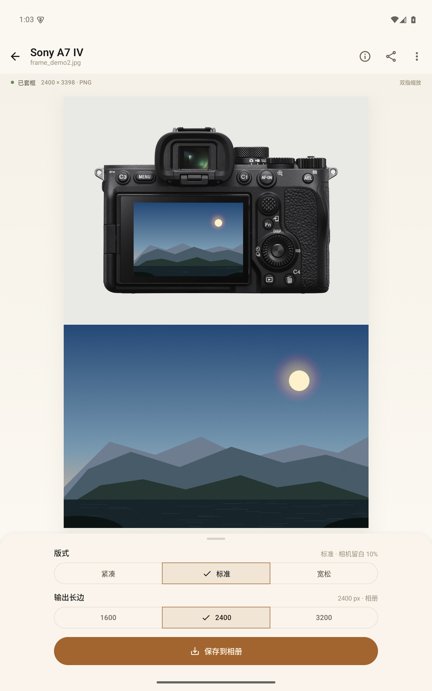

# FotoFrame · Android 原生版

把照片「套」回拍摄它的相机里：读取 EXIF 自动识别机型，把照片按透视贴进相机官方
背面图的屏幕区域，下方排布原始照片，保存成 PNG。界面沿用 macOS 版的纸面/墨色视觉，
交互按手机重做。

> Kotlin · Jetpack Compose · minSdk 29（Android 10）· targetSdk 35
> 26 台相机资产与 macOS 版完全共用（`app/assets/cameras`）。

| 相册 | 编辑器 | 拍摄信息 |
|---|---|---|
|  |  |  |

多选批量套框 / 设置 / 深色：

| 批量选择 | 设置 | 深色 |
|---|---|---|
|  |  |  |

平板下的全屏编辑器（控制面板最大宽度 640dp）：



## 与 macOS 版一致的能力

- **自动识别**：EXIF `Make` / `Model` → 26 台机型；索尼 ILCE 内部编号别名；精确 →
  后缀 → 正则规则，未识别/无 EXIF 时明确提示。
- **EXIF 解析**：JPEG(APP1) · TIFF/DNG · PNG(`eXIf`) · HEIC/HEIF(`meta`→`iinf`/`iloc`)。
  TIFF/DNG 的像素解码使用文件内嵌的 JPEG 预览（相机 RAW 通常都有）。
- **版式**：固定相纸灰 `#E9E9E6`；底部原图左右下三边出血；相机四周留白
  **紧凑 6% / 标准 10% / 宽松 14%**；输出长边 **1600 / 2400 / 3200**。
- **屏幕合成**：逐台标定的屏幕四边形 + 单应透视；默认 cover 铺满裁切，标注
  `contain` 的机型保留完整画面加黑边；`screen.opening` 标注会把玻璃内沿压黑。
- **批量队列**：多选导入、网格多选、批量套框、单张编辑、逐条移除；保存到相册。
- **深色模式**：跟随系统；成图底色始终为相纸灰（与 Mac 一致）。

## 为手机重做的交互

- **系统 Photo Picker 多选**（最多 100 张），不需要存储权限；另有「从文件选择…」
  走 SAF，覆盖 DNG/TIFF 等文件。
- **保存到系统相册** `Pictures/FotoFrame`（MediaStore），不需要存储权限；完成后
  Snackbar 可直接「查看」。
- **系统分享面板**、**复制 PNG 到剪贴板**。
- **相册网格**：单击进编辑器；长按或右上角「选择」进入多选；底部操作条批量
  「套进相机」/删除。多选导入后会自动进入批量准备状态。
- **全屏编辑器**：成图占满主屏，双指缩放/平移/双击放大；版式与输出长边放在
  底部圆角面板，保存为第一主按钮。
- **原生底部导航**（照片 / 编辑 / 设置）、FAB、SegmentedButton、Bottom Sheet、
  Snackbar、长按多选和系统返回栈。
- **照片信息**：机型/识别方式/尺寸/镜头/光圈/快门/ISO/补偿/GPS，用 Material
  Bottom Sheet 展示，复制与分享留在同一处。
- 版式松紧与输出长边写入 SharedPreferences，重启保留。
- 触感反馈、edge-to-edge、状态栏/导航栏深浅自适应；平板网格自适应，编辑器控制
  面板限制最大宽度并居中。
- 从相册/文件管理器 **「打开方式」或「分享到」** 直接进队列；单张导入自动进编辑器，
  多张导入自动准备批量。

## 构建

需要 JDK 17+、Android SDK Platform 35。Android Studio 自带的 JBR 即可：

```bash
cd android
export JAVA_HOME="/Applications/Android Studio.app/Contents/jbr/Contents/Home"
export ANDROID_HOME="$HOME/Library/Android/sdk"

./gradlew testDebugUnitTest     # 核心逻辑测试
./gradlew lintDebug             # Android Lint
./gradlew assembleDebug         # 产物：app/build/outputs/apk/debug/app-debug.apk
```

安装：

```bash
adb install -r app/build/outputs/apk/debug/app-debug.apk
```

`dist/FotoFrame-1.0.0-android.apk` 是本地演示用的 release 包，使用本机 debug keystore
签名（可直接侧载，不可上架）；正式发布请在 `app/build.gradle.kts` 配置自己的
`signingConfigs` 后重新打包。

或者用仓库根目录的封装脚本（自动找 Android Studio JBR / SDK）：

```bash
tools/android.sh assembleDebug
tools/android.sh installDebug
```

> `local.properties` 里的 `sdk.dir` 已在 `.gitignore` 中，不要提交。

## 代码结构

```
android/
├── app/src/main/java/com/fotoframe/app/
│   ├── core/
│   │   ├── catalog/       # 资产模型、catalog 解析、EXIF→机型匹配
│   │   ├── compose/       # FrameTheme / LayoutEngine（与 Dart 版逐行对应）
│   │   └── exif/          # ExifReader（JPEG/TIFF/PNG/HEIF）+ TIFF 预览提取
│   ├── render/            # PhotoDecoder / CameraImageStore / FrameRenderer
│   ├── platform/          # MediaStore 保存、分享、剪贴板
│   ├── model/             # BatchItem、EXIF 展示格式化
│   ├── ui/                # Material 3：相册网格 / 全屏编辑器 / 设置 / 信息 Sheet
│   └── FotoFrameViewModel.kt
├── app/src/test/           # JVM 单元测试（资产、匹配、EXIF、几何、TIFF 预览）
└── app/src/main/res/       # 自适应图标、主题、FileProvider
```

- 相机资产**不复制**：`sourceSets.main.assets.srcDir("../../app/assets")` 直接打包
  仓库已有的 `app/assets/cameras`，与 macOS 版始终同步。
- 版面几何、单应变换、match 优先级、EXIF 解析均与 `app/lib/core` 的 Dart 实现一一对应，
  方便以后两端一起改。

## 验证

- `./gradlew testDebugUnitTest`：覆盖 26 台资产完整性、真实样片 EXIF（JPG/PNG/HEIC）、
  索尼别名、理光后缀、布局/单应/cover-contain、TIFF 内嵌预览。
- 已在 Android 35 arm64 模拟器（1080×2400 手机、1600×2560 平板、横屏）验证：
  相册网格多选 → 批量套框 / 单张编辑 → 1600/2400/3200 导出 → 相册文件尺寸正确；
  深色模式、Photo Picker、SAF、分享面板、剪贴板、EXIF 方向旋转均已走通。

## 已知差异 / 说明

- **保存位置**：Android 没有「选文件夹」概念，统一保存到相册 `Pictures/FotoFrame`，
  重名时由 MediaStore 自动追加 `(1)`。macOS 版是自选文件夹。
- **文件名**：系统 Photo Picker 在部分 Android 版本会隐藏原文件名（返回数字 id）。
  这时用「机型 + EXIF 拍摄时间」生成可读文件名；通过 SAF/分享进入时仍用原名。
- **拖拽**：桌面拖拽不适用；改为系统 Photo Picker + SAF + 分享目标。
- **快捷键**：桌面快捷键不适用；操作入口在相册网格、编辑器底栏与设置页。
- **TIFF/DNG**：只有带内嵌 JPEG 预览的文件能显示；没有预览的 TIFF 会给出明确提示。
- **最小系统**：Android 10（API 29）起；更低版本不在本期范围。

## 隐私

- 未申请 `INTERNET` 权限；照片只在本机读取、合成、写入相册。
- 没有账号、没有统计/崩溃上报、没有广告 SDK。
- 只访问你通过系统选择器主动选择的照片，以及写入本应用创建的相册目录。

## 许可

代码与 macOS 版一致，MIT。相机背面图取自各品牌官方产品图，仅用于本工具合成展示。